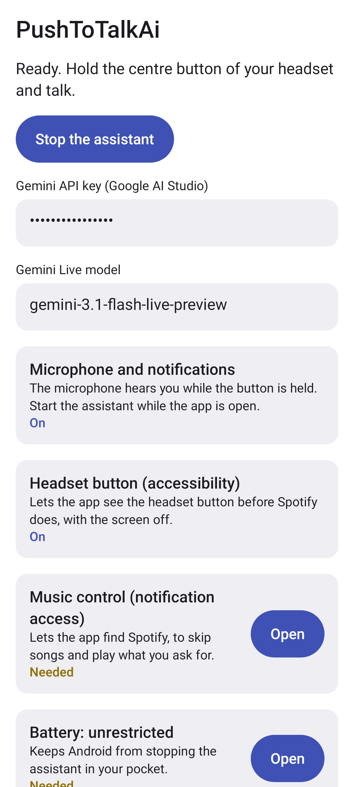
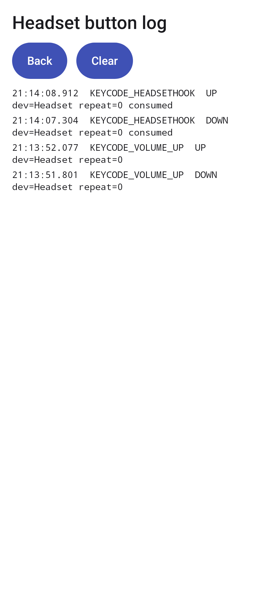

<!-- Generated from readme.yml by LukeNeedham/ci-workflows (docs/readme.md). Edit readme.yml, not this file. -->
<p align="center">
  
</p>

# PushToTalkAi

Hold the centre button of your headset and talk to Gemini, with the phone locked in your pocket.

## Description

PushToTalkAi turns the centre button of wired earphones into a push-to-talk key for a live voice chat with Google Gemini. It
sees the button even with the screen off and Spotify playing, so it fits cycling with the phone in a pocket. Hold the button
while you speak and let go to send: Gemini answers in your ears.

Gemini can control Spotify for you: skip a song, go back, pause or resume, say what is playing, or search for a song and play it.
While the assistant runs, a quick press still plays or pauses, two presses skip and three go back, because the app consumes the button.

The app needs a free Gemini API key from Google AI Studio, which it sends to Google together with your voice. It has no server of its own.

## Screenshots




## Getting started as a user

1. Install the latest build from the [AppHub](https://www.lukeneedham.com/apphub) app, or download the APK from the [Releases](https://github.com/LukeNeedham/PushToTalkAi/releases) page.
2. Create a free API key at Google AI Studio and paste it into the app. Pick another Gemini Live model on the same page if the default is retired.
3. Allow the microphone and notifications, and set the battery of the app to Unrestricted.
4. Turn on the accessibility service **PushToTalkAi headset button**. If Android greys it out, open the App info of the app, use the menu and choose *Allow restricted settings* first.
5. Turn on notification access for **PushToTalkAi music control**: it lets the app find Spotify.
6. Open the app and press *Start the assistant* while it is on screen: Android only gives a background service the microphone when it starts like this. Then lock the phone and hold the centre button of your headset.
7. To check that the button reaches the app with the screen off, press it with the phone locked, then open *Headset button log*.

Requires Android 6.0 (API 23) or newer.

## Getting started as a developer

Requirements: JDK 17 and the Android SDK (platform 36), for example through Android Studio.

```
git clone https://github.com/LukeNeedham/PushToTalkAi.git
cd PushToTalkAi
./gradlew assembleDebug    # the APK is in app/build/outputs/apk/debug/
./gradlew test             # unit tests
```

Every pull request is built by CI, which comments on it with a link to install the APK.

Like all my apps, it follows the shared architecture and conventions (single activity, Jetpack Compose, Navigation 3, MVVM with every page split into a `Page` and a `PageContent`, Koin): see [ci-workflows](https://github.com/LukeNeedham/ci-workflows/blob/main/docs/new-app.md).

The Gemini Live API is used over a WebSocket, with manual activity detection (`activityStart` and `activityEnd`), and the app's
functions are declared in `AssistantToolRunner`. Nothing can be built or run in the sandbox that wrote the code: CI is the build.

## Privacy

Your voice is streamed to Google's Gemini API with your own API key while the button is held. The key is stored in the app's
private storage, and the app has no other server and collects nothing else.

## Contributing

Branch from `main`, make the change, and open a pull request. CI must be green before it is merged.

## License

All rights reserved. See [LICENSE](LICENSE).
